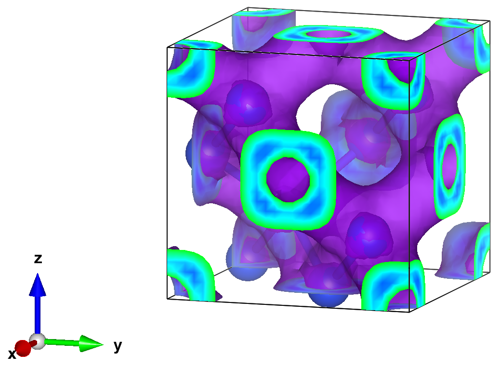

---
jupytext:
  text_representation:
    extension: .md
    format_name: myst
    format_version: 0.13
    jupytext_version: 1.19.1
kernelspec:
  display_name: Python 3 (ipykernel)
  language: ipython3
  name: python3
---

# Si Ground State Energy and Charge Density

In this example, we compute the ground state energy and the real-space charge density of Si in the primitive cell.
The system is the one of {doc}`../../../tutorials/solids/03_Si_writing_H_and_wfn_coqui/03_Si_writing_H_and_wfn_coqui`,
and we use its Quantum ESPRESSO and CoQuí input files, linked in `files/qe` and `files/coqui`.


Unlike for the energy, a Hamiltonian and trial wavefunction file are not enough for the density:
we also need the Kohn-Sham orbitals to put it on a real-space grid, and they have to come from the same Quantum ESPRESSO run.
Another run mixes degenerate bands differently, so its orbitals do not match the basis of the Hamiltonian.
We therefore run Quantum ESPRESSO and CoQuí here again.

Set `QE_BIN` to the directory holding `pw.x` and `pw2coqui.x`, and `COQUI_EXEC` and `AFQMC_EXEC` to the
CoQuí and SAFIRE executables.
All calculations run in a scratch directory `data`.

```{code-cell} ipython3
# create scratch directory in notebook path
%mkdir -p {_dh[0]}/data
%cd -q {_dh[0]}/data

import xml.etree.ElementTree as ET

import h5py
import matplotlib.pyplot as plt
import numpy as np
from safiretools import Results, Wavefunction, vis, write_jobfile
```

## Hamiltonian, Trial Wavefunction, and Orbitals

As in the tutorial, Quantum ESPRESSO computes 20 bands at the $\Gamma$ point and writes them to `OUT`,
and CoQuí writes the Hamiltonian `hamil.h5` and the trial wavefunction `wfn.h5` in the basis of these bands.
Their output goes to the `*.out` files.

```{code-cell} ipython3
!$QE_BIN/pw.x -inp ../files/qe/scf.in > scf.out
!$QE_BIN/pw.x -inp ../files/qe/nscf.in > nscf.out
!$QE_BIN/pw2coqui.x < ../files/qe/pw2coqui.in > pw2coqui.out
```

```{code-cell} ipython3
!$COQUI_EXEC ../files/coqui/hamil.toml > hamil.out
!$COQUI_EXEC ../files/coqui/wfn.toml > wfn.out
```

## Charge Density from the One-Body Density Matrix

SAFIRE measures the one-body density matrix in the basis of the Kohn-Sham orbitals $\phi_i(\mathbf{r})$,
$\rho^\sigma_{ij} = \langle c^\dagger_{i\sigma} c_{j\sigma} \rangle$. The charge density is

$$
n(\mathbf{r}) = \sum_\sigma \sum_{ij} \phi^*_i(\mathbf{r})\, \rho^\sigma_{ij}\, \phi_j(\mathbf{r}).
$$

The density matrix does not commute with the Hamiltonian, so we use the back-propagated estimator
(see {doc}`../../../tutorials/solids/04_computing_observables/04_computing_observables`).

## Run AFQMC

The energy estimator is on by default.
The `backprop` block measures the back-propagated density matrix at each back-propagation length in `bp_lengths`, given in steps.
A new window starts every `max(bp_lengths)` steps after equilibration, so each length gives one sample per window.
Comparing the lengths tells us whether the density is converged in the back-propagation length.

```{code-cell} ipython3
dt = 0.01
bp_lengths = [100, 200]
write_jobfile("afqmc.json", {
    "seed": 7,
    "execute": {
        "wavefunction": {"filename": "wfn.h5"},
        "hamiltonian": {"filename": "hamil.h5"},
        "timestep": dt,
        "steps": 10000,
        "equilibration_steps": 1000,
        "measure_interval": 10,
        "population_control_interval": 10,
        "walker_ortho_interval": 10,
        "num_walkers": 800,
        "estimators": {
            "backprop": {"propagation_steps": bp_lengths, "onerdm": {}},
        },
    },
})
```

```{code-cell} ipython3
:tags: [scroll-output]

!mpirun -n 16 $AFQMC_EXEC afqmc.json
```

## Ground State Energy

```{code-cell} ipython3
results = Results("afqmc.results.h5")

energy, energy_err = results.average("Energy")
print(f"E = {energy.real:.4f} ± {energy_err.real:.4f} Ha")

vis.plot_timeseries(results)
plt.show()
```

This is the system of {doc}`../../../tutorials/solids/01_hello_safire/01_hello_safire`,
so the energy should agree with `Energy = -0.7299 ± 0.0017` there within the stochastic uncertainty.

## Charge Density

We evaluate the orbitals on the real-space grid of Quantum ESPRESSO.
`pwscf.xml` holds the lattice vectors, the atomic positions and the grid,
and `pwscf.save/wfc1.hdf5` the plane-wave coefficients $c_i(\mathbf{G})$ of the bands at the only k-point, $\Gamma$.
An inverse FFT gives $\phi_i(\mathbf{r}) = \Omega^{-1/2} \sum_\mathbf{G} c_i(\mathbf{G})\, e^{i\mathbf{G}\cdot\mathbf{r}}$ with the cell volume $\Omega$,
so the density comes out in electrons per Bohr$^3$.

```{code-cell} ipython3
def read_qe_orbitals(outdir, prefix="pwscf"):
    """Lattice vectors and atomic positions (Bohr), and the Gamma-point orbitals on the FFT grid."""
    xml = ET.parse(f"{outdir}/{prefix}.xml").getroot()
    structure = xml.find(".//atomic_structure")
    cell = np.array([structure.find(f"cell/a{i}").text.split() for i in (1, 2, 3)], dtype=float)
    positions = np.array([atom.text.split() for atom in structure.iter("atom")], dtype=float)
    mesh = np.array([xml.find(".//fft_grid").get(f"nr{i}") for i in (1, 2, 3)], dtype=int)

    with h5py.File(f"{outdir}/{prefix}.save/wfc1.hdf5") as f:
        m = f["MillerIndices"][...] % mesh
        evc = f["evc"][...].view(complex)  # plane-wave coefficients, (bands, G)
    coeffs = np.zeros((len(evc), *mesh), dtype=complex)
    coeffs[:, m[:, 0], m[:, 1], m[:, 2]] = evc
    phi = np.fft.ifftn(coeffs, axes=(1, 2, 3)) * mesh.prod() / np.sqrt(abs(np.linalg.det(cell)))
    return cell, positions, phi


def charge_density(rdm, phi):
    """Charge density on the grid of `phi`, from the density matrix."""
    rho = rdm.sum(axis=0) # sum over spin (assumes collinear)
    # n(r) = sum_i phi_i^*(r) (rho phi)_i(r)
    n = np.einsum("i...,i...->...", phi.conj(), np.tensordot(rho, phi, axes=1)).real
    return n
```

The density is linear in the density matrix, so `Results.evaluate` gives its mean and a jackknife error
directly from the samples at each back-propagation length.
For reference, the DFT density follows from the density matrix of the trial determinant $\Phi$,
$\rho^\sigma_{ij} = \sum_n \Phi^{\sigma*}_{in} \Phi^\sigma_{jn}$, which has no uncertainty.

```{code-cell} ipython3
cell, positions, phi = read_qe_orbitals("OUT")

alpha, beta = Wavefunction.from_hdf5("wfn.h5").determinant(0)
dft_rdm = np.array([alpha.conj() @ alpha.T, beta.conj() @ beta.T])
n_dft = charge_density(dft_rdm, phi)

n_bp, n_bp_err = {}, {}
for L in bp_lengths:
    n_bp[L], n_bp_err[L] = results.evaluate(
        lambda rdm: charge_density(rdm, phi), [f"BackPropEstimator/Steps={L}/OneRDM"]
    )
    print(f"BP {L}: max |n - n_DFT| = {abs(n_bp[L] - n_dft).max():.2e}, max error {n_bp_err[L].max():.2e}")
```

We plot the densities in the $(110)$ plane, which contains both atoms of the cell and the Si-Si bond between them.
On the grid along the lattice vectors $\mathbf{a}_1, \mathbf{a}_2, \mathbf{a}_3$,
it is the slice of grid points with equal first and second index.

```{code-cell} ipython3
def plane_110(n, cell):
    """`n` in the (110) plane through the atoms, over 2x2 cells."""
    n1, _, n3 = n.shape
    v = cell / np.array(n.shape)[:, None]  # grid steps along the lattice vectors
    i, k = np.meshgrid(np.arange(2 * n1 + 1), np.arange(2 * n3 + 1), indexing="ij")
    r = i[..., None] * (v[0] + v[1]) + k[..., None] * v[2]
    # orthonormal axes in the plane: along a3 = [-110], and the rest of a1 + a2 = [001]
    e1 = v[2] / np.linalg.norm(v[2])
    e2 = v[0] + v[1] - (v[0] + v[1]) @ e1 * e1
    e2 /= np.linalg.norm(e2)
    return r @ e1, r @ e2, n[i % n1, i % n1, k % n3]


x, y, dft_plane = plane_110(n_dft, cell)
dn = {L: plane_110(n_bp[L] - n_dft, cell)[2] for L in bp_lengths}
dn_max = max(abs(d).max() for d in dn.values())

fig, axes = plt.subplots(1, 1 + len(bp_lengths), figsize=(4.5 * (1 + len(bp_lengths)), 4), sharey=True)
im = axes[0].pcolormesh(x, y, dft_plane, shading="gouraud")
fig.colorbar(im, ax=axes[0])
axes[0].set_title("DFT")
for ax, L in zip(axes[1:], bp_lengths):
    im = ax.pcolormesh(x, y, dn[L], shading="gouraud", cmap="RdBu_r", vmin=-dn_max, vmax=dn_max)
    fig.colorbar(im, ax=ax)
    ax.set_title(rf"AFQMC $-$ DFT, $\tau_\mathrm{{BP}} = {L * dt:g}$ Ha$^{{-1}}$")
for ax in axes:
    ax.set_aspect("equal")
    ax.set_xlabel(r"$[\bar{1}10]$ (Bohr)")
axes[0].set_ylabel("$[001]$ (Bohr)")
fig.tight_layout()
```

The DFT density piles up on the bonds, and the difference shows how correlation redistributes the charge.
It should agree between the back-propagation lengths within the error; otherwise, increase `bp_lengths`.

## Removing Systematic Errors

There are several systematic errors, each controlled by a specific parameter, that we will need to remove for high-quality results.

1. the Trotter error, which is removed by converging in the `timestep`, or by extrapolating to zero timestep
2. the Cholesky error, controlled by the tolerance `tol` in `files/coqui/hamil.toml`
3. the basis set incompleteness error, controlled by the number of bands `nbnd` in the CoQuí inputs,
   which is limited by the number of bands of the one-shot DFT calculation in `files/qe/nscf.in`
4. the finite-size error, controlled by the k-point mesh of the one-shot DFT calculation.
   Here we used only the $\Gamma$ point of the primitive cell, which is far from converged.

These errors are formally interdependent; however, good values for each parameter can typically be found independently and used together in a production run.

## Interacting with Third-Party Software

To plot the density with third-party software such as [VESTA](https://jp-minerals.org/vesta/en/), we can write it to a Gaussian cube file.
The file lists the atoms with their atomic numbers, 14 for Si, and the grid steps along the lattice vectors,
followed by the values with the last grid index running fastest.

```{code-cell} ipython3
def write_cube(filename, data, cell, positions, numbers):
    """Write `data` on the grid spanned by the lattice vectors `cell` to a Gaussian cube file, all in Bohr."""
    with open(filename, "w") as f:
        f.write("Gaussian cube file\nwritten by write_cube\n")
        f.write(f"{len(numbers):5d}" + 3 * f"{0:12.6f}" + "\n")  # number of atoms, origin
        for n, a in zip(data.shape, cell):
            f.write(f"{n:5d}" + "".join(f"{x:12.6f}" for x in a / n) + "\n")  # grid points, step vector
        for Z, r in zip(numbers, positions):
            f.write(f"{Z:5d}{Z:12.6f}" + "".join(f"{x:12.6f}" for x in r) + "\n")
        for row in data.reshape(-1, data.shape[2]):
            for start in range(0, len(row), 6):  # at most 6 values per line
                f.write("".join(f"{x:14.6e}" for x in row[start:start + 6]) + "\n")


numbers = [14] * len(positions)
write_cube("rho_dft.cube", n_dft, cell, positions, numbers)
for L in bp_lengths:
    write_cube(f"rho_bp{L}.cube", n_bp[L], cell, positions, numbers)
    write_cube(f"rho_bp{L}_err.cube", n_bp_err[L], cell, positions, numbers)
```

For example, this isosurface plot of the charge density of Si was made with VESTA from a calculation in the conventional cell,
with an isosurface value of 0.0023 electrons per grid point, about 0.042 electrons per Bohr$^3$ in the units of `write_cube`.


