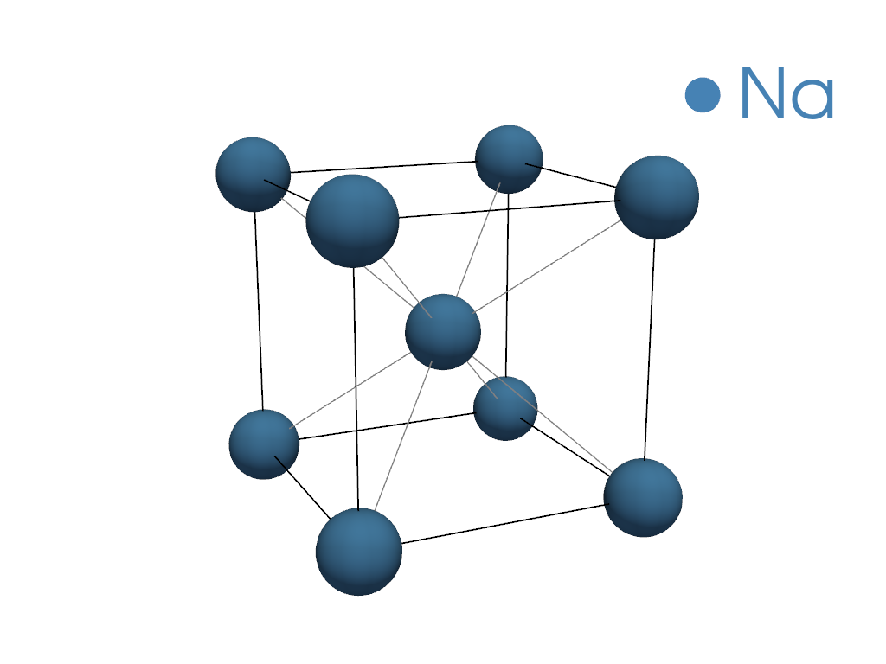
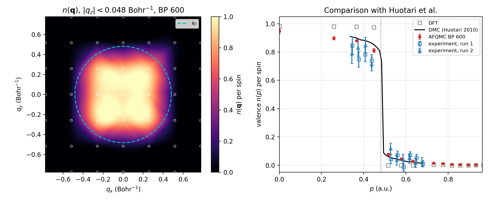

---
jupytext:
  text_representation:
    extension: .md
    format_name: myst
    format_version: 0.13
    jupytext_version: 1.19.1
kernelspec:
  display_name: Python 3 (ipykernel)
  language: ipython3
  name: python3
---

# Momentum Distribution of Solid Na

In this example, we compute the valence momentum distribution $n(\mathbf{q})$ of bcc sodium with
back-propagated AFQMC and compare it with the Compton-scattering experiment and DMC of
[Huotari *et al.*, Phys. Rev. Lett. 105, 086403 (2010)](https://doi.org/10.1103/PhysRevLett.105.086403).

## System

We use the 2-atom cubic cell of bcc Na at the density of the experiment, $r_s = 3.99$, which gives
$a = 8.1036$ Bohr (4.288 Å).
The [ccECP](https://pseudopotentiallibrary.org) pseudopotential has a Ne core, so each atom has 1 valence electron.
A $3\times3\times3$ k-point mesh makes the AFQMC supercell 54 atoms with 54 electrons,
which fill the free-electron shells 1 + 6 + 12 + 8 per spin exactly.



## Momentum Distribution from the One-Body Density Matrix

SAFIRE measures the one-body density matrix in the basis of Kohn-Sham Bloch orbitals,
$\rho_{ij}(\mathbf{k}) = \langle c^\dagger_{i\mathbf{k}} c_{j\mathbf{k}} \rangle$, which is block-diagonal in $\mathbf{k}$.
Expanding each orbital in plane waves, $\psi_{i\mathbf{k}}(\mathbf{r}) \propto \sum_\mathbf{G} c_{i\mathbf{k}}(\mathbf{G})\, e^{i(\mathbf{k}+\mathbf{G})\cdot\mathbf{r}}$,
gives the occupation of momentum $\mathbf{q} = \mathbf{k}+\mathbf{G}$:

$$
n(\mathbf{k}+\mathbf{G}) = \sum_{ij} c^*_{i\mathbf{k}}(\mathbf{G})\, \rho_{ij}(\mathbf{k})\, c_{j\mathbf{k}}(\mathbf{G}).
$$

The density matrix does not commute with the Hamiltonian, so we use the back-propagated estimator
(see {doc}`../../../tutorials/solids/04_computing_observables/04_computing_observables`).
The plane-wave coefficients come from the QE wavefunction files, and `files/nq_tools.py` does the unfolding.

Set `QE_BIN` to the directory holding `pw.x` and `pw2coqui.x`, and `COQUI_EXEC` and `AFQMC_EXEC` to the
CoQuí and SAFIRE executables.

```{code-cell} ipython3
import csv
import shutil
from pathlib import Path

import h5py
import matplotlib.pyplot as plt
import numpy as np
from safiretools import Results, Wavefunction, write_jobfile

from files.nq_tools import fermi_wavevector, plot_slab, radial_average, read_qe_orbitals, unfold_nq

NP = 12  # MPI ranks
data = Path("data")
for step in ["1_dft_qe", "2_coqui"]:
    shutil.copytree(Path("files") / step, data / step, dirs_exist_ok=True)
(data / "3_safire").mkdir(exist_ok=True)
```

## Step 1: DFT with Quantum ESPRESSO

An scf run on an $8\times8\times8$ mesh gives the density, and an nscf run computes 40 bands on the
$3\times3\times3$ mesh without symmetry reduction. `pw2coqui.x` converts the result for CoQuí.

```{code-cell} ipython3
!cd {data}/1_dft_qe && mpirun -n {NP} $$QE_BIN/pw.x -in scf.in > scf.out
!cd {data}/1_dft_qe && mpirun -n {NP} $$QE_BIN/pw.x -in nscf.in > nscf.out
!cd {data}/1_dft_qe && $$QE_BIN/pw2coqui.x -in pw2coqui.in > pw2coqui.out
```

## Step 2: Hamiltonian and Trial Wavefunction with CoQuí

CoQuí writes the Hamiltonian in the basis of the lowest 19 bands per k (513 orbitals), with Cholesky-decomposed
two-electron integrals, and the Kohn-Sham determinant as the trial wavefunction.
19 bands reach about 19 eV above the Fermi energy without splitting a degenerate level.

```{code-cell} ipython3
!cat {data}/2_coqui/input.toml
```

```{code-cell} ipython3
!cd {data}/2_coqui && mpirun -n {NP} $$COQUI_EXEC input.toml > coqui.out

with h5py.File(data / "2_coqui/hamiltonian.h5") as f:
    kpoints = f["System/BZ/kpoints"][...]
    volume = abs(np.linalg.det(f["System/lattice_vectors"][...]))
    occ = f["Orbitals/occ"][...]  # Kohn-Sham occupations per spin, (1, nk, M)
nk, M = occ.shape[1:]
k_F = fermi_wavevector(volume, 2)  # 2 valence electrons per cell
print(f"nk = {nk}, NMO = {nk * M}, k_F = {k_F:.4f} Bohr^-1")
```

## Step 3: Run AFQMC

CoQuí writes a collinear trial with identical spin determinants. We rebuild it as a closed-shell trial,
so that SAFIRE can use closed-shell walkers, which propagate one spin.
The back-propagated density matrix is measured at each back-propagation length in `bp_lengths`.
A new window starts every `max(bp_lengths)` steps after equilibration, so each length gives one sample per window.

```{code-cell} ipython3
alpha, beta = Wavefunction.from_hdf5(data / "2_coqui/wfn.h5").determinant(0)
assert np.allclose(alpha, beta)

bp_lengths = [100, 200]
# bp_lengths = [100, 200, 400, 600] # takes some time
write_jobfile(data / "3_safire/afqmc.json", {
    "seed": 7,
    "execute": {
        "wavefunction": Wavefunction.from_single_determinant(alpha),
        "hamiltonian": {"filename": "../2_coqui/hamiltonian.h5"},
        "timestep": 0.01,
        "steps": 5000,
        "equilibration_steps": 600,
        "measure_interval": 10,
        "population_control_interval": 10,
        "walker_ortho_interval": 10,
        "num_walkers": 40,
        "estimators": {
            "energy": None,
            "backprop": {"propagation_steps": bp_lengths, "onerdm": {}},
        },
    },
})
```

```{code-cell} ipython3
:tags: [scroll-output]

!cd {data}/3_safire && mpirun -n {NP} $$AFQMC_EXEC afqmc.json
```

## Step 4: Momentum Distribution

We unfold the Kohn-Sham occupations for the DFT $n(\mathbf{q})$, and the back-propagated density matrix inside
`Results.evaluate` for jackknife error bars on its radial average.
Each BP sample is separated by a window length, so for long window lengths we can assume they are weakly
correlated and set `rebinsize=1`.

```{code-cell} ipython3
results = Results(data / "3_safire/afqmc.results.h5")

qvecs, coeffs = read_qe_orbitals(data / "1_dft_qe/OUT/pwscf.save", kpoints, M)
qmag = np.linalg.norm(qvecs, axis=1)
edges = np.linspace(0, 2.5 * k_F, 81)
q_bins = radial_average(qmag, qmag, edges)[0]

def radial_nq(rdm):
    return radial_average(qmag, unfold_nq(rdm, coeffs), edges)[1]

n_dft = radial_nq(np.diag(occ.ravel())[None])

bp = {}
for L in bp_lengths:
    bp[L] = results.evaluate(radial_nq, [f"BackPropEstimator/Steps={L}/OneRDM"], rebinsize=1)
above = np.argmax(q_bins > k_F)  # first radial bin above k_F
print(f"n(q) at |q| = {q_bins[above]:.3f} Bohr^-1: DFT {n_dft[above]:.3f}")
for L, (n, dn) in bp.items():
    print(f"  BP {L:3d}: {n[above]:.3f} +/- {dn[above]:.3f}")
```

Back propagation moves electrons above $k_\mathrm{F}$, and the amount still grows with the back-propagation length.

## Comparison with DMC and Experiment

The experimental and DMC data were extracted from Fig. 1 of Huotari *et al.* and are per spin, so we divide ours by 2.
Our cell has the experimental density, so we compare on absolute momentum.

```{code-cell} ipython3
with open("files/huotari2010_fig1_nofp.csv") as f:
    rows = list(csv.DictReader(line for line in f if not line.startswith("#")))

def huotari(series, *columns):
    return np.array([[float(r[c]) for c in columns] for r in rows if r["series"] == series]).T

max_bp_length = max(bp_lengths)

bp_rdm, _ = results.average(f"BackPropEstimator/Steps={max_bp_length}/OneRDM", rebinsize=1)

fig, (ax0, ax1) = plt.subplots(1, 2, figsize=(11, 4.5))
plot_slab(ax0, qvecs, unfold_nq(bp_rdm, coeffs) / 2, k_F)
ax0.set_title(ax0.get_title() + f", BP {max_bp_length}")

ax1.plot(q_bins, n_dft / 2, "s", color="0.5", mfc="none", ms=6, label="DFT")
n, dn = bp[max_bp_length]
ax1.errorbar(q_bins, n / 2, yerr=dn / 2, fmt="o", color="C3", ms=4, capsize=2, label=f"AFQMC BP {max_bp_length}")
p, n = huotari("QMC", "p_au", "n")
ax1.plot(p, n, "k-", lw=1.5, label="DMC (Huotari 2010)")
for series, marker, label in [("exp_run1", "s", "experiment, run 1"), ("exp_run2", "^", "experiment, run 2")]:
    p, n, dn = huotari(series, "p_au", "n", "n_err")
    ax1.errorbar(p, n, yerr=dn, fmt=marker, color="C0", mfc="none", ms=5, capsize=2, label=label)
ax1.axvline(k_F, color="0.3", ls=":", lw=1)
ax1.set(xlabel=r"$p$ (a.u.)", ylabel=r"valence $n(p)$ per spin", xlim=(0, 2 * k_F), ylim=(-0.05, 1.05),
        title="Comparison with Huotari et al.")
ax1.grid(alpha=0.3)
ax1.legend(fontsize=8)
fig.tight_layout()
fig.savefig(data / "nq_Na.png", dpi=200)
```



The left panel shows the back-propagated $n(\mathbf{q})$ per spin in the $q_z = 0$ plane, with the Fermi sphere
dashed.
On the right, our points are drawn without connecting lines, because the $3\times3\times3$ mesh samples only a few
shells of $|\mathbf{q}|$.
At $\tau_\mathrm{BP} = 6$ Ha$^{-1}$ we obtain good agreement with DMC and experiment, but a production run should
converge the back-propagation length, the basis set, the timestep error, and the population control bias.
